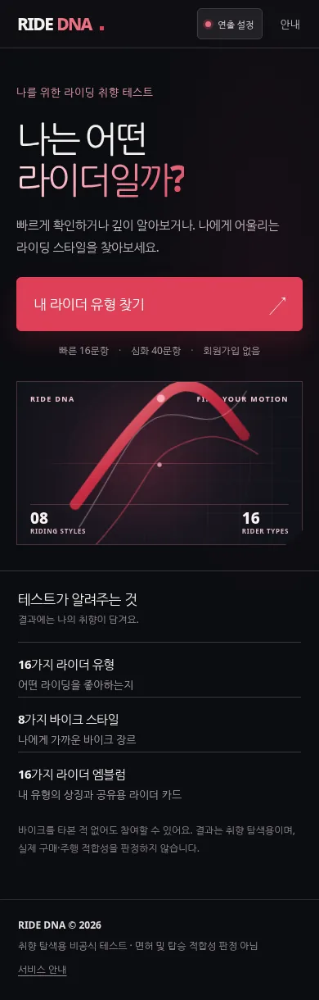
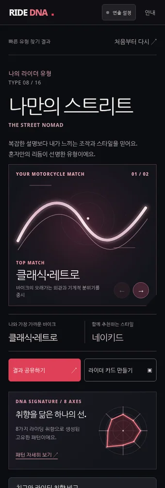

# RIDE DNA

### 나에게 어울리는 라이딩 스타일은 무엇일까?

**내가 어떤 라이더인지, 어떤 모터사이클 스타일에 끌리는지 발견하는 짧은 웹게임.**  
질문에 답하고, 나만의 라이더 유형을 확인하고, 친구에게 결과를 공유해 보세요.

[**라이더 유형 찾기 →**](https://1m58ine.github.io/Ride-DNA/)　·　[이용 안내](https://1m58ine.github.io/Ride-DNA/about.html)

**무료**　·　**회원가입 없음**　·　**모바일 & PC**　·　**설치 불필요**

 

 

## 내 라이딩의 취향을 발견하는 방법

RIDE DNA는 사람마다 다른 **라이딩 목적, 조작감, 여행 선호, 편안함, 디자인 감성** 등을 바탕으로 나의 취향을 가볍게 탐색하는 서비스입니다. 정답은 없어요. 평소 자신의 생각에 가까운 답을 고르면 됩니다.

<table>
<tr>
<td width="50%" valign="top">
<h3>⚡ 빠른 유형 찾기</h3>

<strong>16문항 · 약 3분</strong>

지금 가장 중요하게 생각하는 라이딩 취향을 가볍게 확인할 수 있어요. 처음이라면 이 검사부터 추천해요.

</td>
<td width="50%" valign="top">
<h3>◇ 진지한 유형 찾기</h3>

<strong>40문항 · 추가 질문 가능</strong>

16개의 공통 질문에 24개의 선호도 질문을 더해 취향을 깊이 살펴봐요. 이미 빠른 검사를 끝냈다면 이어서 진행할 수도 있어요.

</td>
</tr>
</table>

**이렇게 진행돼요.** 검사 방식 선택 → 질문에 답하기 → 라이더 유형 공개 → 바이크 스타일 확인 → 결과 공유.

## 결과를 더 즐겁게

### 01. 나의 라이더 유형

**16가지 라이더 유형** 중 나에게 가까운 스타일이 공개됩니다. 짧은 결과 공개 연출은 건너뛸 수 있어요.

### 02. MOTORCYCLE MATCH

**8가지 바이크 장르** 중 가장 가까운 두 스타일을 확인할 수 있어요. 결과 화면의 화살표로 추천 장르별 그래픽과 설명을 넘겨 보세요.

### 03. DNA SIGNATURE

8가지 라이딩 취향으로 만든 **시각적 패턴**을 살펴보세요. 자세히 보기를 누르면 각 취향 지표를 확인할 수 있어요.

### 04. RIDER ID & RIDER DUO

결과 카드를 **NOIR / VELOCITY / SIGNATURE** 세 가지 디자인으로 저장하거나, 친구의 결과와 비교할 수 있어요. 카카오톡 직접 공유는 사이트 운영자의 카카오 설정이 완료된 경우 이용할 수 있어요.

### 05. 선택형 예상 MBTI

바이크 취향만으로 MBTI를 결정하지 않아요. 원하는 경우에만 **별도 성격 질문**에 답하거나 본인이 알고 있는 MBTI를 입력할 수 있어요.

 

<table><tr>
<td align="center" width="50%"> 검사 방식 선택</td>
<td align="center" width="50%"> 시각적으로 즐기는 나의 결과</td>
</tr></table>

 

## 편리하게, 가볍게

| | |
|:--|:--|
| **바로 시작** | 계정 등록이나 설치 없이 브라우저에서 실행 |
| **이어서 하기** | 진행 중인 검사는 같은 브라우저에 저장 |
| **결과 저장** | PNG 카드, 링크 복사 및 지원 기기의 공유 메뉴 |
| **화면 연출** | 기본 · 화려하게 · 움직임 끄기 |
| **기기 대응** | 스마트폰 세로·가로, 태블릿, PC |
| **데이터 처리** | 검사 답변은 브라우저에 보관하며 별도 자체 서버로 전송하지 않음 |

> **결과에 대한 안내**  
> RIDE DNA는 재미를 위한 **비공식 라이딩 취향 게임**입니다. 장르 점수는 자체 계산한 선호 유사도이며, 통계적으로 검증된 심리검사·안전성 평가·실제 구매 적합도 판정이 아니에요. 예상 MBTI도 공식 MBTI 검사 결과가 아닙니다.

---

<strong>개발·배포 안내 보기</strong>

이 프로젝트는 **HTML · CSS · JavaScript**로 제작한 정적 웹앱입니다. GitHub Pages에 바로 배포할 수 있고 별도의 백엔드나 데이터베이스가 필요하지 않습니다.

- 배포 및 운영 방법: [DEPLOYMENT.md](./docs/DEPLOYMENT.md)
- 업데이트 기록: [CHANGELOG.md](./CHANGELOG.md)
- 채점 모델 설명: [TEST_MODEL.md](./TEST_MODEL.md)
- 보안·검증 범위: [SECURITY_REVIEW.md](./SECURITY_REVIEW.md)

**RIDE DNA** — Find your riding identity.

[테스트 시작하기](https://1m58ine.github.io/Ride-DNA/)

