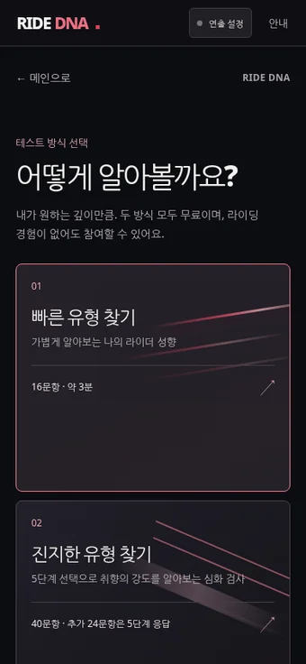
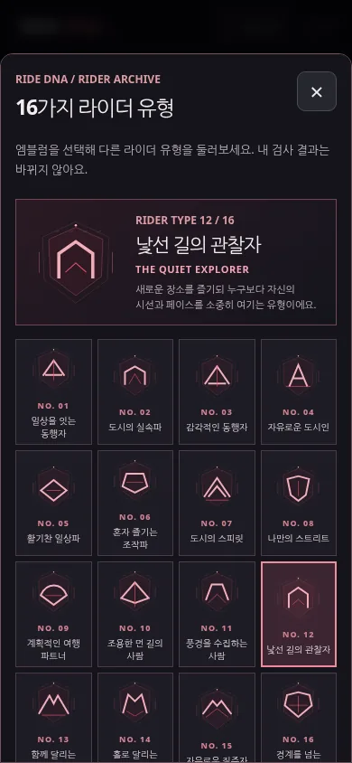
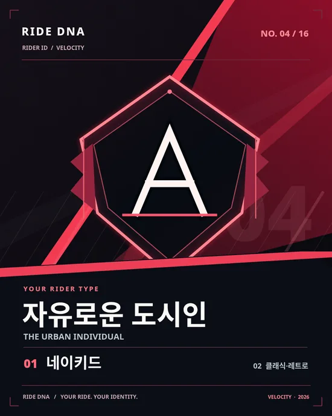
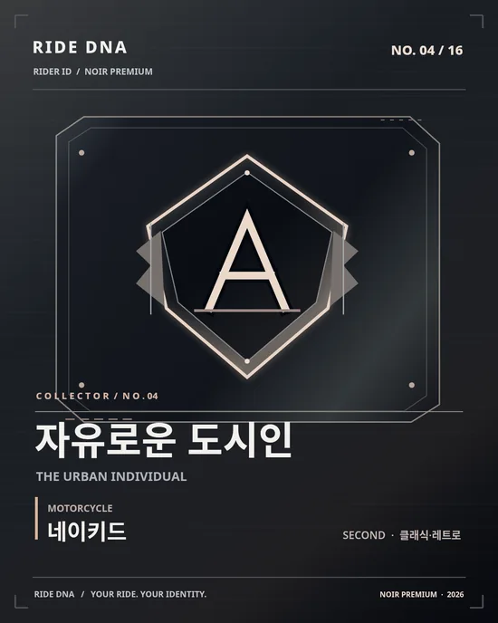
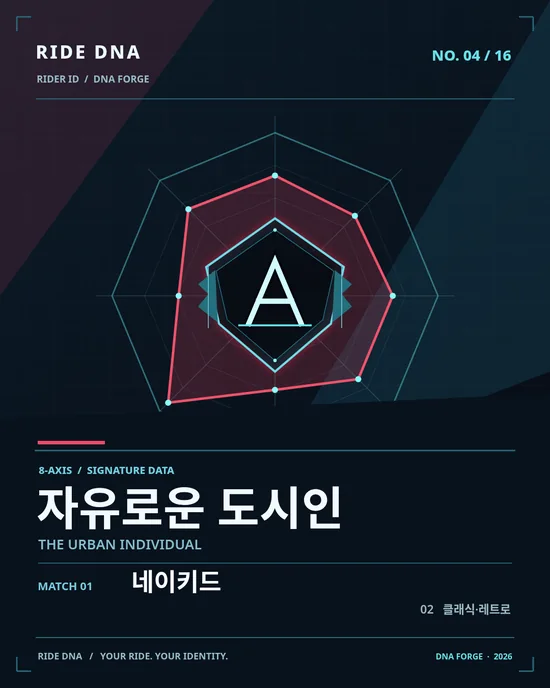
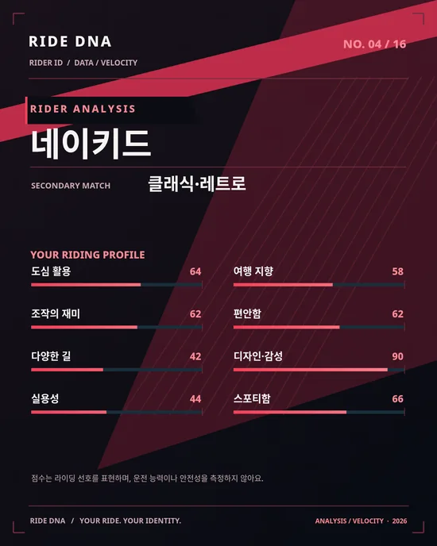

# RIDE DNA
### FIND YOUR RIDING IDENTITY

**나는 어떤 라이더일까?**  
간단한 질문으로 라이딩 취향을 찾고, **나만의 라이더 엠블럼과 컬렉터 카드를 만들어 보세요.**

[**바로 테스트하기 ↗**](https://1m58ine.github.io/Ride-DNA/)　　[서비스 안내](https://1m58ine.github.io/Ride-DNA/about.html)

`무료`　`회원가입 없음`　`모바일 · PC`　`설치 불필요`

 

 

## 내 취향을 발견하는 두 가지 방법

가볍게 시작할 수도, 조금 더 진지하게 살펴볼 수도 있어요. **빠른 검사 16문항**은 기존처럼 간편하게 진행하고, **심화 검사는 총 40문항**으로 취향을 더 자세히 탐색합니다.

| ⚡ 빠른 유형 찾기 | ◆ 진지한 유형 찾기 |
|:--|:--|
| **16문항** · 약 3분 | **40문항** · 추가 적응형 질문 가능 |
| 네 가지 선택지에서 가장 가까운 답변을 선택 | 공통 16문항 + **5단계 동의형 24문항** |
| 처음 방문했을 때 추천 | 취향의 강도와 장르 차이를 자세히 살펴보고 싶을 때 |

**빠른 검사를 완료했나요?** 같은 16문항을 다시 풀지 않고 심화 검사로 이어갈 수 있어요.

---

## 결과가 나오는 순간까지, 하나의 경험

<table><tr>
<td width="52%" valign="top">

### 01 — YOUR RIDER TYPE

검사를 마치면 **16가지 라이더 유형** 중 나의 스타일이 공개됩니다. 각 유형에는 고유한 벡터 엠블럼이 있어요. 결과 공개 연출은 언제든 건너뛸 수 있습니다.

</td>
<td align="center" valign="middle"></td>
</tr></table>

### 02 — MOTORCYCLE MATCH

**8가지 바이크 장르** 중 가까운 스타일 두 가지를 소개합니다. 추천 장르별 그래픽을 넘겨보고, 심화 분석에서는 8개 장르를 비교할 수 있습니다.

### 03 — RIDER ARCHIVE

**16개 유형의 엠블럼 도감**에서 다른 라이더 유형과 설명을 살펴보세요. 도감을 둘러보더라도 내 검사 결과는 변하지 않아요.

### 04 — RIDER CARD REVOLUTION

테스트를 마쳤다면 **나만의 라이더 카드**를 만들어 보세요. 유형에 맞는 대형 엠블럼과 추천 바이크 스타일이 **1080px 고해상도 카드**로 완성됩니다. 테마마다 색상만 바뀌는 것이 아니라 그래픽 구성과 정보 배치가 달라집니다.

<table><tr>
<td align="center" width="33%"> <strong>VELOCITY</strong> 속도와 강렬함</td>
<td align="center" width="33%"> <strong>NOIR PREMIUM</strong> 메탈릭 프리미엄</td>
<td align="center" width="33%"> <strong>DNA FORGE</strong> 내 취향의 시각화</td>
</tr></table>

**앞면은 RIDER IDENTITY**, **뒷면은 RIDER ANALYSIS**. 카드를 뒤집으면 추천 장르와 실제 검사에서 얻은 **8가지 취향 지표**를 확인할 수 있어요. 공유 링크에서 연 카드에는 세부 답변 데이터가 없으므로 없는 점수를 지어내지 않습니다.

**4:5 피드 · 9:16 스토리 · 1:1 정사각형**, 세 가지 크기로 앞면과 뒷면을 각각 PNG 저장할 수 있습니다. PC에서는 포인터, 모바일에서는 터치에 반응하는 미세한 카드 기울기 효과를 제공하며, 동작 줄이기 설정에서는 꺼집니다. 외부 업로드 없이 브라우저에서 이미지를 만듭니다.

### 05 — RIDER DUO

친구와 결과 링크를 주고받고 두 사람의 선호 스타일을 비교해 보세요. **서버 없는 요약 결과 비교**이므로 별도 계정도 필요하지 않습니다.

---

## 누구나 편하게

- **모바일 우선:** 세로·가로 스마트폰, 태블릿, PC에 대응합니다.
- **빠른 진행:** 답변을 누르면 다음 질문으로 넘어가며, 검사 도중 나가도 같은 브라우저에서 이어할 수 있어요.
- **움직임 선택:** `기본 / 화려하게 / 움직임 끄기` 중 선택할 수 있습니다.
- **쉽게 공유:** 결과 링크 복사, 기기 공유, 카드 앞·뒷면 PNG 저장. 카카오톡 직접 공유는 사이트 운영자의 카카오 SDK 설정이 된 경우에 사용할 수 있습니다.
- **성격 검사 제거:** 비공식 예상 MBTI 기능은 제공하지 않습니다. **라이딩 취향 자체에 집중**합니다.

> **알아두세요**  
> RIDE DNA는 재미를 위한 **비공식 라이딩 취향 게임**입니다. 점수는 자체 계산한 취향 일치 지표로, 심리검사 타당도·실제 구매 적합성·주행 안전을 검증하는 수치가 아닙니다. 유형별 엠블럼과 시각 효과는 결과를 꾸미는 표현이며 채점에 영향을 주지 않습니다.

---

<strong>🔧 개발 및 배포 정보</strong>

RIDE DNA는 **HTML · CSS · Vanilla JavaScript**로 만들어진 정적 웹앱입니다. 별도의 PHP, DB, 계정 시스템 없이 GitHub Pages에서 동작하도록 설계했습니다. 진행 상태는 해당 브라우저의 로컬 저장소에 보관합니다.

- [배포·카카오 설정 안내](./docs/DEPLOYMENT.md)
- [변경 사항](./CHANGELOG.md)
- [검사 모델 설명](./TEST_MODEL.md)
- [보안 및 테스트 범위](./SECURITY_REVIEW.md)

실기기 및 GitHub Pages 최종 검증은 배포 후 별도로 확인해야 합니다. 실제 앱의 JavaScript·이미지 리소스는 브라우저에서 확인할 수 있으므로 비밀키를 포함하면 안 됩니다.

 

**RIDE DNA — YOUR RIDE. YOUR IDENTITY.**

[**나의 라이더 유형 찾기 →**](https://1m58ine.github.io/Ride-DNA/)

